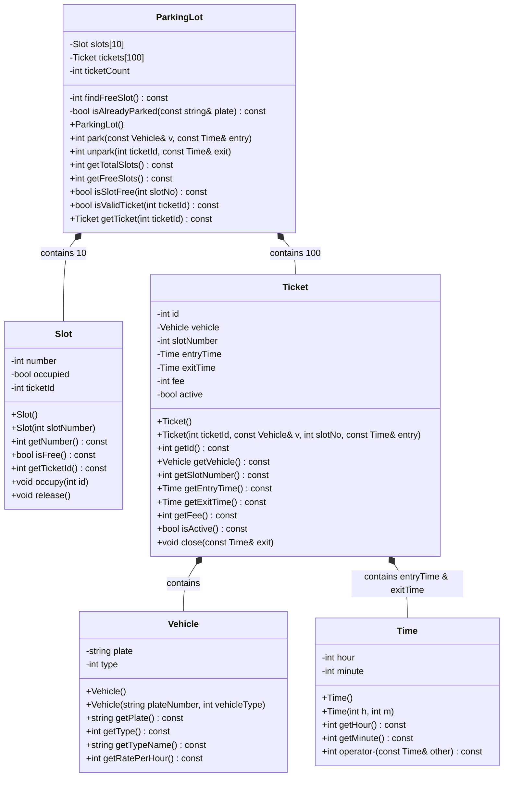
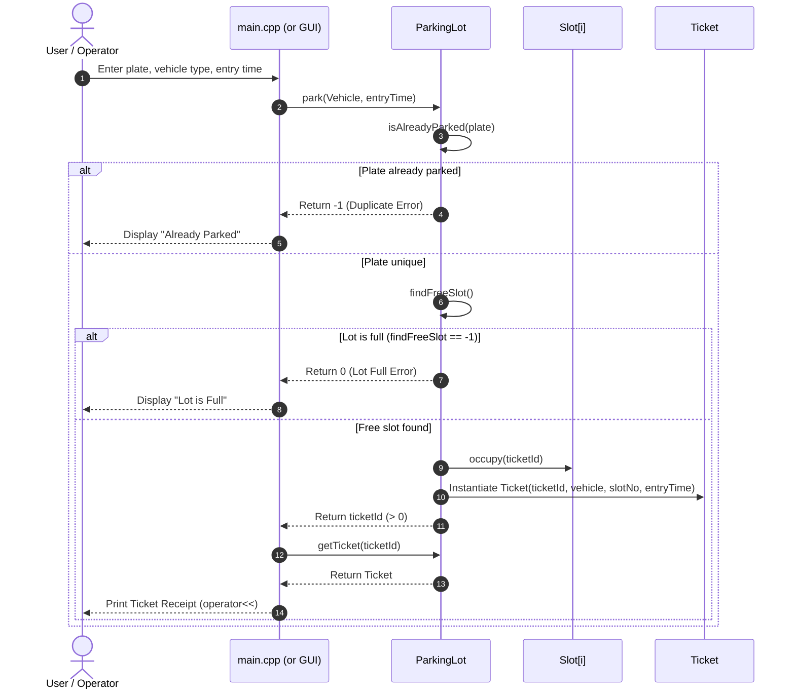
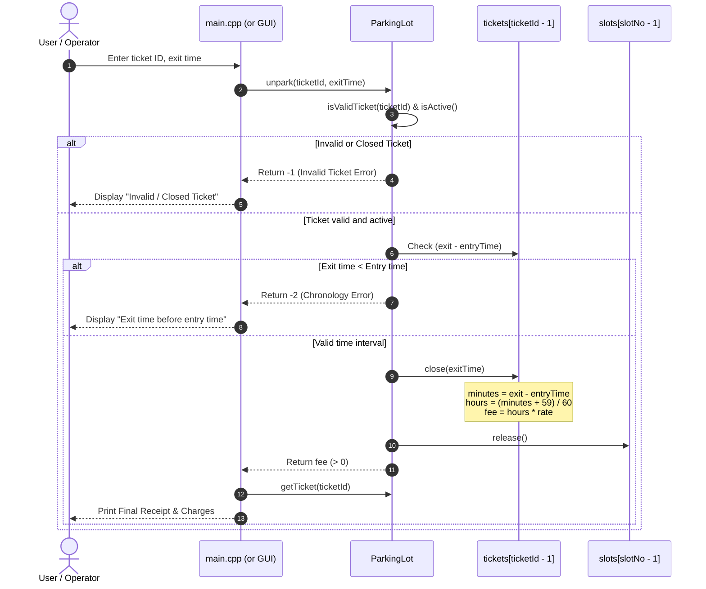

# Project Report: Smart Parking Lot Management System

**Course:** Object-Oriented Programming in C++  
**Level:** Sophomore / 2nd Year B.Tech / B.E. Computer Science & Engineering  
**Project Repository:** [Smart-Parking-System](https://github.com/TaperBubbles04/Smart-Parking-System.git)  
**Branch:** `visual`  
**Date:** October 2026  

---

## 1. Executive Summary & Problem Statement

Urban congestion and the proliferation of vehicular traffic have turned parking space management into a major logistical bottleneck. Manual parking management suffers from significant inefficiencies:
- Arbitrary slot allocation leading to traffic choke points inside the facility.
- Human calculation errors and disputes in hourly fee assessment.
- Lack of immediate visibility into lot occupancy and vehicle dwell times.
- Security and tracking risks resulting from handwritten, easily lost paper chits.

The **Smart Parking Lot Management System** is a software solution written in modern C++ that automates vehicle intake, slot allocation, ticket issuance, time tracking, and tariff calculation. Developed as a core Object-Oriented Programming project, it prioritizes robust modularity, data security, and maintainability by rigorously applying fundamental OOP principles: **Encapsulation**, **Abstraction**, **Composition**, **Operator Overloading**, and **Interface-Implementation Separation**.

---

## 2. Project Architecture & File Organization

The project adheres to professional software engineering standards by decoupling class declarations (interfaces) from class definitions (implementations).

### Directory & File Structure

```
Smart-Parking-System/
├── .gitignore             # Excludes binaries, object files, and IDE build artifacts
├── README.md              # Project overview, build instructions, and sample runs
├── REPORT.md              # Comprehensive academic OOP report (this document)
├── Code/
│   ├── ParkingSystem.h    # Unified Interface: Declarations of all five domain classes
│   ├── Time.cpp           # Implementation: Time arithmetic and stream formatting
│   ├── Vehicle.cpp        # Implementation: Vehicle metadata and rate mapping
│   ├── Slot.cpp           # Implementation: Parking slot state tracking
│   ├── Ticket.cpp         # Implementation: Ticket lifecycle and fee calculation
│   ├── ParkingLot.cpp     # Implementation: Lot orchestration (park/unpark algorithms)
│   └── main.cpp           # Test Driver: Menu CLI and presentation logic
└── Visual_CPP/
    ├── ParkingLot_Win32.cpp # Visual C++ desktop GUI implementation
    └── README_VISUAL_CPP.md # Visual C++ GUI setup and execution guide
```

### Architectural Rationale
1. **Separation of Concerns:** All standard I/O (`cin`, `cout`) is isolated strictly within `main.cpp`. The core classes (`ParkingLot`, `Ticket`, `Slot`, `Vehicle`, `Time`) contain zero presentation logic and communicate strictly via parameters and return values.
2. **GUI Swappability:** Because the domain layer does not depend on `main.cpp`, the entire command-line interface can be swapped for a Graphical User Interface (such as the Visual C++ desktop GUI in `Visual_CPP/ParkingLot_Win32.cpp`) without modifying a single line of the underlying business logic.
3. **Single Translation Header:** `ParkingSystem.h` orders class declarations sequentially based on dependency order: `Time` $\rightarrow$ `Vehicle` $\rightarrow$ `Slot` $\rightarrow$ `Ticket` $\rightarrow$ `ParkingLot`. Each `.cpp` file compiles independently against this shared interface.

---

## 3. Detailed Mapping of OOP Concepts

| OOP Concept | Core Implementation in Project | Direct Code Reference |
| :--- | :--- | :--- |
| **Classes & Objects** | 5 distinct entity models (`Time`, `Vehicle`, `Slot`, `Ticket`, `ParkingLot`) | [ParkingSystem.h](file:///home/taper/Smart-Parking-System/Code/ParkingSystem.h) |
| **Constructors** | Default and parameterized constructors for every class | [Time.cpp](file:///home/taper/Smart-Parking-System/Code/Time.cpp#L4-L12), [Vehicle.cpp](file:///home/taper/Smart-Parking-System/Code/Vehicle.cpp#L3-L12), [Slot.cpp](file:///home/taper/Smart-Parking-System/Code/Slot.cpp#L3-L12), [Ticket.cpp](file:///home/taper/Smart-Parking-System/Code/Ticket.cpp#L3-L17), [ParkingLot.cpp](file:///home/taper/Smart-Parking-System/Code/ParkingLot.cpp#L3-L8) |
| **Encapsulation & Data Hiding** | Private attributes across all classes; public getters and mutators enforce class invariants | [Slot.h](file:///home/taper/Smart-Parking-System/Code/ParkingSystem.h#L45-L61), [Ticket.h](file:///home/taper/Smart-Parking-System/Code/ParkingSystem.h#L65-L90) |
| **Abstraction** | Main driver only calls high-level `park()` and `unpark()`; internal allocation, ticket index math, and duplicate detection remain hidden | [ParkingLot.cpp](file:///home/taper/Smart-Parking-System/Code/ParkingLot.cpp#L27-L66) |
| **Class Composition ("Has-A")** | `ParkingLot` contains arrays of `Slot` and `Ticket`; `Ticket` contains `Vehicle` and two `Time` objects | [ParkingSystem.h](file:///home/taper/Smart-Parking-System/Code/ParkingSystem.h#L66-L74), [ParkingSystem.h](file:///home/taper/Smart-Parking-System/Code/ParkingSystem.h#L99-L103) |
| **Operator Overloading** | `operator-` calculates minute difference between two `Time` instances; `operator<<` stream insertion formats `Time` and `Ticket` | [Time.cpp](file:///home/taper/Smart-Parking-System/Code/Time.cpp#L22-L36), [Ticket.cpp](file:///home/taper/Smart-Parking-System/Code/Ticket.cpp#L50-L68) |

---

### Concept 1: Classes, Objects & Instantiation

A class is a user-defined blueprint grouping state (data members) and behavior (member functions). An object is an instantiated memory resident of that blueprint.

- **`Time` Class:** Models the temporal dimension with 24-hour hour (`hour`) and minute (`minute`) members.
- **`Vehicle` Class:** Models vehicles entering the premises with license plate (`plate`) and vehicle classification code (`type`: 1 = Bike, 2 = Car, 3 = Truck).
- **`Slot` Class:** Represents individual physical parking bays with slot identifier (`number`), occupancy flag (`occupied`), and associated ticket reference (`ticketId`).
- **`Ticket` Class:** Represents a legal parking contract containing identification (`id`), the parked `Vehicle`, slot reference (`slotNumber`), timestamp objects (`entryTime`, `exitTime`), computed tariff (`fee`), and active status (`active`).
- **`ParkingLot` Class:** The top-level controller orchestrating the entire system.

---

### Concept 2: Constructors (Default & Parameterized)

Constructors guarantee that objects never exist in an uninitialized or corrupt state upon allocation.

1. **Default Constructors:** Provide safe initial state values when arrays of objects are instantiated in memory:
   ```cpp
   Slot::Slot() {
       number = 0;
       occupied = false;
       ticketId = 0;
   }
   ```
   *Why this matters:* When `ParkingLot` instantiates `Slot slots[MAX_SLOTS];`, C++ automatically invokes `Slot::Slot()` for each of the 10 elements. The `ParkingLot` constructor then explicitly initializes each slot's number from 1 to 10:
   ```cpp
   ParkingLot::ParkingLot() {
       for (int i = 0; i < MAX_SLOTS; i++) {
           slots[i] = Slot(i + 1); // 1-indexed slot numbers
       }
       ticketCount = 0;
   }
   ```

2. **Parameterized Constructors:** Enforce atomic initialization with validated values:
   ```cpp
   Vehicle::Vehicle(std::string plateNumber, int vehicleType) {
       plate = plateNumber;
       type = vehicleType;
   }
   ```

---

### Concept 3: Encapsulation & Data Hiding

Encapsulation packages data members and the methods operating on them into a single unit while restricting direct external access via access specifiers (`private` vs. `public`).

#### Why It Protects System Integrity:
- **Preventing Inconsistent States:** In `Slot`, the variable `occupied` and `ticketId` are `private`. An external caller cannot accidentally toggle `occupied = false` while `ticketId` remains non-zero. The only way to modify slot state is through the synchronized member functions `occupy(int id)` and `release()`:
  ```cpp
  void Slot::occupy(int id) {
      occupied = true;
      ticketId = id;
  }
  void Slot::release() {
      occupied = false;
      ticketId = 0;
  }
  ```
- **Read-Only Invariants:** In `Ticket`, `fee` is private and cannot be set directly from outside. It can only be computed mathematically inside `Ticket::close(const Time& exit)` based on the vehicle's rate and time elapsed. This prevents tampering with financial calculations.

---

### Concept 4: Abstraction

Abstraction separates *what* a module does from *how* it achieves it. The complexity of algorithms is encapsulated behind a simple, high-level API.

#### Abstraction in `ParkingLot`:
The presentation layer (`main.cpp` or a GUI) needs only two primary actions:
1. `lot.park(vehicle, entryTime)`
2. `lot.unpark(ticketId, exitTime)`

The caller has zero visibility into:
- How slots are searched (linear scan in `findFreeSlot()`).
- How duplicate license plates are detected (`isAlreadyParked()`).
- How tickets are indexed in the array (`tickets[ticketCount]`).
- How duration is computed and rounded up to hourly brackets.

```
+-----------------------------------------------------------+
|                     PRESENTATION LAYER                    |
|             (main.cpp / Visual C++ GUI Window)            |
+-----------------------------------------------------------+
                             |
             Calls public API: park(), unpark()
                             v
+-----------------------------------------------------------+
|                      ABSTRACTION BARRIER                  |
|                 (ParkingLot Public Interface)             |
+-----------------------------------------------------------+
                             |
     Hides: findFreeSlot(), isAlreadyParked(), fee math
                             v
+-----------------------------------------------------------+
|                     INTERNAL SUBSYSTEMS                   |
|       Slot[10], Ticket[100], Time Arithmetic, Vehicle     |
+-----------------------------------------------------------+
```

---

### Concept 5: Class Composition ("Has-A" Relationship)

Composition is a form of association where a compound object contains one or more component objects. In composition, the component object's lifetime is bound to the owner object's lifetime (strong ownership).

#### Composition Hierarchy:
1. **`ParkingLot` HAS-A `Slot` array:**
   ```cpp
   Slot slots[MAX_SLOTS]; // 10 Slot objects embedded directly inside ParkingLot
   ```
2. **`ParkingLot` HAS-A `Ticket` array:**
   ```cpp
   Ticket tickets[MAX_TICKETS]; // 100 Ticket records embedded inside ParkingLot
   ```
3. **`Ticket` HAS-A `Vehicle` and `Time` objects:**
   ```cpp
   class Ticket {
   private:
       Vehicle vehicle;   // Composed Vehicle instance
       Time entryTime;    // Composed Entry Timestamp
       Time exitTime;     // Composed Exit Timestamp
       ...
   };
   ```

#### Memory & Lifetime Implications:
- When a `Ticket` object is created, memory for its `Vehicle`, `entryTime`, and `exitTime` sub-objects is allocated inline.
- When `ParkingLot` is allocated on the stack in `main()`, all memory for 10 `Slot` objects and 100 `Ticket` objects is allocated contiguously on the stack. No dynamic heap fragmentation occurs, and destruction is completely deterministic.

---

### Concept 6: Operator Overloading

Operator overloading allows user-defined types to integrate naturally with standard C++ language operators, making code intuitive, concise, and idiomatic.

#### 1. Overloading Binary Arithmetic Subtraction (`-`)
In `Time`, the `-` operator is overloaded as a `const` member function to calculate the time difference in elapsed minutes:
```cpp
int Time::operator-(const Time& other) const {
    int thisMinutes  = hour * 60 + minute;
    int otherMinutes = other.hour * 60 + other.minute;
    return thisMinutes - otherMinutes;
}
```
*Usage in `Ticket::close()`:*
```cpp
int minutes = exit - entryTime; // Intuitive subtraction of two Time objects!
```
Without operator overloading, the programmer would have been forced to write cumbersome method calls like `exit.subtractAndConvertToMinutes(entryTime)`.

#### 2. Overloading Stream Insertion Operator (`<<`)
The `<<` operator is overloaded as a non-member friend/external function for both `Time` and `Ticket`:
- **`Time::operator<<` (12-Hour AM/PM Formatting):**
  ```cpp
  std::ostream& operator<<(std::ostream& out, const Time& t) {
      int h = t.getHour() % 12;
      if (h == 0) h = 12; // 0 -> 12 AM, 12 -> 12 PM
      const char* period = (t.getHour() < 12) ? "AM" : "PM";
      out << std::setw(2) << std::setfill('0') << h << ":"
          << std::setw(2) << std::setfill('0') << t.getMinute() << " " << period;
      out << std::setfill(' '); // Reset fill to prevent formatting leaks
      return out;
  }
  ```
- **`Ticket::operator<<` (Receipt Generation):**
  ```cpp
  std::ostream& operator<<(std::ostream& out, const Ticket& t) {
      out << "\n------- PARKING TICKET -------\n";
      out << "Ticket ID : " << t.getId() << "\n";
      out << "Vehicle   : " << t.getVehicle().getPlate() << " (" << t.getVehicle().getTypeName() << ")\n";
      out << "Slot      : " << t.getSlotNumber() << "\n";
      out << "Entry     : " << t.getEntryTime() << "\n"; // Cascaded stream insertion of Time
      if (t.isActive()) {
          out << "Status    : PARKED\n";
      } else {
          out << "Exit      : " << t.getExitTime() << "\n";
          out << "Fee       : Rs. " << t.getFee() << "\n";
          out << "Status    : CLOSED\n";
      }
      out << "------------------------------\n";
      return out;
  }
  ```
*Usage in `main.cpp`:*
```cpp
cout << lot.getTicket(id); // Prints full receipt cleanly via chained streams!
```

---

## 4. System UML Diagrams

### Class Diagram



---

### Sequence Diagram: Vehicle Parking Flow



---

### Sequence Diagram: Vehicle Unparking & Fee Calculation Flow



---

## 5. Business Rules & Fee Calculation Formulas

### 1. Tariff Schedule
- **Bike (Type 1):** ₹10 per hour
- **Car (Type 2):** ₹20 per hour
- **Truck (Type 3):** ₹40 per hour

### 2. Time Delta & Ceiling Formula
Given an entry time $T_{\text{entry}}$ and exit time $T_{\text{exit}}$, elapsed duration in minutes is computed via operator overloading:
$$\Delta M = T_{\text{exit}} - T_{\text{entry}}$$

Any fraction of an hour is charged as a full hour using integer ceiling arithmetic:
$$H = \left\lfloor \frac{\Delta M + 59}{60} \right\rfloor$$

To enforce the minimum 1-hour charge policy:
$$H_{\text{billable}} = \max(1, H)$$

$$\text{Total Fee} = H_{\text{billable}} \times \text{RatePerHour}$$

*Example:* A car parking from 09:30 AM to 11:05 AM incurs $\Delta M = 95\text{ minutes}$.  
$H = (95 + 59) / 60 = 154 / 60 = 2\text{ hours}$.  
$\text{Fee} = 2 \times ₹20 = ₹40$.

---

## 6. Defensive Programming & Validation Matrix

| Test Scenario | Input Condition | System Handling | Return Code / Message |
| :--- | :--- | :--- | :--- |
| **Normal Park** | Plate: `TN01AB1234`, Type: `2`, Time: `9 30 AM` | Allocates first free slot (Slot 1), creates Ticket 1 | Ticket ID `1`, Status: `PARKED` |
| **Duplicate Vehicle** | Re-entering `TN01AB1234` while ticket 1 is active | Blocked by `isAlreadyParked()` check | Returns `-1` ("Vehicle already parked") |
| **Capacity Exhaustion** | 11th vehicle enters when 10 slots are occupied | Blocked by `findFreeSlot() == -1` | Returns `0` ("Sorry, parking lot is full") |
| **Normal Unpark** | Ticket ID `1`, Exit: `11 05 AM` | Computes 2 hours duration, frees Slot 1 | Fee: `Rs. 40`, Status: `CLOSED` |
| **Non-existent Ticket** | Ticket ID `99` | Blocked by `isValidTicket()` check | Returns `-1` ("Invalid or already closed") |
| **Double Unpark** | Unparking Ticket 1 a second time | Blocked by `!tickets[id-1].isActive()` check | Returns `-1` ("Invalid or already closed") |
| **Chronology Violation**| Entry: `11 00 AM`, Exit: `10 30 AM` | Blocked by `(exit - entry) < 0` check | Returns `-2` ("Exit cannot be before entry") |
| **Invalid Time Format**| User enters `14 75 PM` or strings | Blocked by `readTime()` stream validator | Reprompts user until valid |

---

## 7. Viva-Voce Questions & Model Answers

### Q1. Why did you split the project into `ParkingSystem.h` and multiple `.cpp` files?
**Answer:** This enforces the **Interface-Implementation Separation Principle**. The header file contains only class specifications (attributes, constructor prototypes, method signatures) and acts as an API contract. The `.cpp` files contain the compiled definitions. This provides:
1. **Encapsulation:** Callers do not see internal algorithmic implementations.
2. **Compilation efficiency:** Modifying one class implementation does not require recompiling untouched classes.
3. **Pluggable Frontend:** The entire presentation layer (`main.cpp`) can be swapped for a GUI (e.g. Visual C++ Desktop GUI) without altering a single domain class.

### Q2. How is Operator Overloading implemented in your `Time` class?
**Answer:** The binary subtraction operator `-` is overloaded as a member function:
`int Time::operator-(const Time& other) const;`
It converts both times to minutes since midnight ($h \times 60 + m$) and returns the integer difference. It is declared `const` because subtracting two times does not modify the invoking object.
The stream insertion operator `<<` is overloaded as a non-member function returning `std::ostream&` by reference to enable cascaded stream operations (e.g., `cout << t1 << t2;`).

### Q3. Explain the difference between Composition and Aggregation in your project.
**Answer:** Composition is a strong "has-a" relationship where the child object's lifetime is bound to the parent. In our project:
- `ParkingLot` **composes** `Slot slots[10]` and `Ticket tickets[100]`.
- `Ticket` **composes** `Vehicle vehicle`, `Time entryTime`, and `Time exitTime`.
The component objects are allocated inline on the stack inside the parent. When the `ParkingLot` object goes out of scope, all slots and tickets are automatically destroyed. In contrast, aggregation would involve storing raw pointers to objects managed elsewhere.

### Q4. Why are data members declared `private`? What happens if they are `public`?
**Answer:** Declaring data members `private` enforces **Data Hiding** and prevents external code from breaking class invariants. For example, if `Slot::occupied` were public, client code could alter it to `false` without clearing `ticketId`, causing slot corruption. With private members, all state modifications pass through validated methods (`occupy()` and `release()`).

### Q5. Why is `main.cpp` the only file containing `cin` and `cout`?
**Answer:** This adheres to the **Single Responsibility Principle** and **Decoupled Architecture**. Domain classes (`ParkingLot`, `Ticket`, etc.) model parking lot mechanics, not terminal interactions. Quarantining I/O in `main.cpp` ensures that the domain classes can be reused without modification in any UI environment, including Visual C++ GUI, Qt, or mobile frontends.

---

## 8. Roadmap to Final-Semester Version

| Feature | Mid-Sem (Current) | Final-Sem (Planned) |
| :--- | :--- | :--- |
| **Inheritance** | Single `Vehicle` class with integer `type` | Abstract base class `Vehicle` with derived `Bike`, `Car`, and `Truck` subclasses |
| **Polymorphism** | `switch (type)` and `if (type == 1)` logic | Pure virtual function `virtual int getRatePerHour() const = 0;` dynamically dispatched |
| **Dynamic Memory** | Value objects in `Ticket` | Pointer-to-base `Vehicle*` in `Ticket` with virtual destructors and deep copying |
| **STL Containers** | Fixed arrays `slots[10]`, `tickets[100]` | `std::vector<Slot>`, `std::vector<Ticket>`, `std::map<int, Ticket>` |
| **Exception Handling** | Integer return codes (`-1`, `-2`, `0`) | Custom exceptions: `LotFullException`, `DuplicatePlateException`, `InvalidTicketException` |
| **File Persistence** | Ephemeral (RAM only) | Stream persistence (`std::ifstream`, `std::ofstream`) saving lot state across runs |
| **User Interface** | Console CLI (`main.cpp`) | Graphical User Interface (Visual C++ Desktop GUI in `Visual_CPP/`) |
